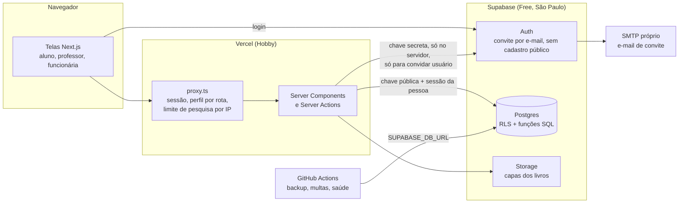
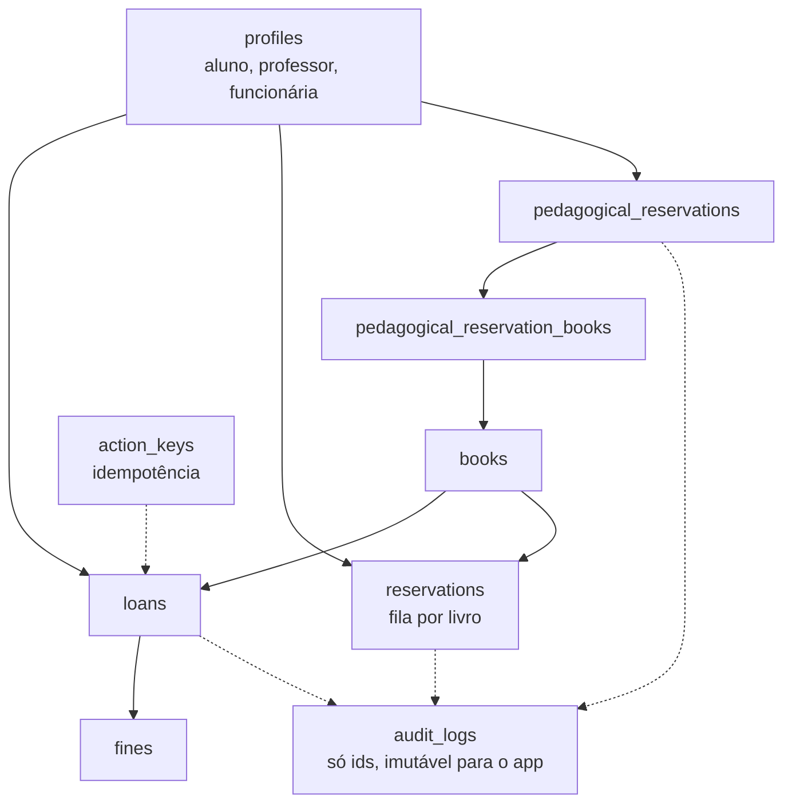

# System design do FAP Books

Resumo do porquê da arquitetura: componentes, dados, carga esperada, decisões (ADRs) e quando crescer. Os detalhes de cada parte ficam nos documentos citados; aqui está o quadro geral. Card 0232 (parte do 0225).

Complementa: [arquitetura.md](../arquitetura.md) (pastas e regras de dependência), [database/modelo-de-dados.md](../database/modelo-de-dados.md) (tabelas e RLS), [infra-e-plano-gratuito.md](../infra-e-plano-gratuito.md) (limites, agendadas, prova de carga) e [prd.md](../prd.md) (requisitos).

## 1. Componentes

- **Navegador:** só recebe HTML e o JavaScript necessário. Nenhuma chave secreta chega a ele.
- **proxy.ts:** primeira porta. Renova a sessão, manda cada perfil para a própria área e limita a pesquisa (`?q=`) por IP. As páginas conferem o perfil de novo (`requireRole`): o proxy não é a única defesa.
- **Server Components e Actions:** todo acesso ao Supabase passa por `src/services/`. A leitura usa a sessão da pessoa, então o RLS vale. A chave secreta só existe em `src/lib/supabase/admin-client.ts` (convidar usuário), depois de conferir que quem pede é funcionária.
- **Banco:** as regras que não podem falhar moram no Postgres (ver seção 2), não só no código.
- **GitHub Actions:** tarefas agendadas fora do app (seção 4).

## 2. Dados e regras

Tabelas: `profiles`, `books`, `loans`, `fines`, `reservations`, `pedagogical_reservations`, `pedagogical_reservation_books`, `audit_logs`, `action_keys` e `newsletter_subscribers`. Todas com RLS ligado. O desenho completo está em `database/modelo-de-dados.md`.

Regras de negócio no banco (funções `security definer` com `search_path` vazio, só para usuário logado, conferindo o perfil dentro da função):

| Regra | Onde |
| -- | -- |
| Limite de 3 livros por usuário (4 para formandos), exemplar livre, fila de reserva | `loans_enforce_integrity`, `create_loan`, `return_loan`, `renew_loan` |
| Prazo de 7 dias; renovação até 3 vezes somando 7 dias ao prazo atual | funções de empréstimo e renovação |
| Multa de R$ 1,00 por dia (dias corridos, fuso America/Sao_Paulo); baixa só presencial | `pay_fine`, tarefa agendada de multas |
| Reserva pedagógica (até 30 dias): pedir, registrar no balcão, aprovar/recusar, devolver | `request_`, `register_in_person_`, `decide_`, `return_pedagogical_reservation` |
| Painel e edição/inativação de usuários | `panel_summary`, `update_profile_admin`, `set_profile_active` |
| Concorrência: dois pedidos do último exemplar, só um passa | `select ... for update` no livro e no perfil, sempre na mesma ordem |
| Clique duplo e nova tentativa não duplicam | chave de idempotência por ação (`claim_action_key`, `action_keys`) |

Auditoria: `audit_logs` guarda só identificadores (LGPD), é imutável para o app e tem política de retenção de 24 meses (ver `infra-e-plano-gratuito.md`).

## 3. Carga esperada (hipóteses a validar)

A biblioteca atende a comunidade de uma faculdade. Os números abaixo são **hipóteses de projeto**, não medição:

| Item | Hipótese | Por que importa |
| -- | -- | -- |
| Usuários cadastrados | centenas a poucos milhares | o plano gratuito comporta; a lista de usuários é paginada |
| Acervo | até 20 mil títulos | a busca precisa de índice e paginação; o teste de carga usa essa meta |
| Pico simultâneo | 50 pessoas (início de semestre) | meta do card 0225: p95 abaixo de 500 ms e zero erro com 50 usuários |
| Escritas | dezenas de empréstimos por dia | baixo; o cuidado é correção (concorrência), não volume |
| Banco hoje | 13 MB com 20 livros | limite do plano: 500 MB; alerta em 80% |

Leitura domina a escrita: pesquisa de livros é a rota mais quente. Por isso a busca, os contadores e a disponibilidade são funções SQL com paginação (nunca ler o acervo inteiro em memória), e só dado compartilhado entra em cache.

## 4. Decisões (ADRs)

| # | Decisão | Motivo | Consequência |
| -- | -- | -- | -- |
| 1 | Backend em Next.js (Server Actions) + Supabase; NestJS adiado | Time em aprendizado, menos peças, plano gratuito (registrado no PRD) | Regras críticas no banco para não depender de um servidor de API |
| 2 | Regras que não podem falhar viram funções SQL transacionais, não código de tela | Concorrência e integridade (limite, exemplar, fila) só são garantidas no banco | Testes SQL em `supabase/tests/` rodam em Postgres descartável |
| 3 | RLS em toda tabela e leitura com a sessão da pessoa | Aluno e professor só veem o que é deles | Chave secreta fora do navegador, usada só para convidar |
| 4 | Idempotência por chave de ação | Clique duplo e falha de rede não duplicam empréstimo ou multa | Tabela `action_keys` |
| 5 | Cache (`use cache` + `cacheTag`) só para dado compartilhado (categorias); dado por usuário nunca | O RLS torna cada resposta diferente por pessoa | Escritas chamam `invalidateCatalogCache()` |
| 6 | `` simples nas capas, com `loading="lazy"` | O otimizador de imagem da Vercel tem cota própria no plano gratuito | Capas pequenas (2 MB) e cache de 1 ano |
| 7 | Limite por IP em memória (pesquisa, newsletter) e no Supabase Auth (login) | Custo zero | **Não é global** (cada instância tem a sua memória); a garantia global é o WAF da Vercel, a cargo do dono |
| 8 | Tarefas agendadas no GitHub Actions executando SQL idempotente, em lote com limite | Usa o segredo que já existe (`SUPABASE_DB_URL`), sem conta nova; multa nunca é calculada na leitura | O GitHub só agenda a partir da `main` e pausa repositório sem atividade por 60 dias |
| 9 | Cadastro público do Supabase desligado; pessoa nova entra por convite | Impede conta de estranho (perfil nasce como aluno ativo) e abuso do e-mail | Convite pela funcionária usa a chave de servidor |
| 10 | SMTP próprio (Gmail na fase piloto) | O e-mail padrão do Supabase é limitado e sem identidade | Gmail serve ao piloto; para uso real, trocar por Resend ou Brevo com domínio |
| 11 | Orçamento de JavaScript no CI (`scripts/orcamento-bundle.mjs`) | Evitar piorar o desempenho sem perceber | Teto sobe de propósito, no mesmo PR, com explicação |
| 12 | Auditoria só com ids, 24 meses de retenção, apagar só com decisão humana | LGPD e custo de armazenamento | Workflow semanal conta; apagar é manual |

## 5. Observabilidade e operação

- **Backup:** diário, criptografado (`database/backup.md`).
- **Saúde do Supabase (semanal):** mantém o projeto ativo, mede banco e arquivos (alerta em 80%), conta auditoria antiga, lista consultas lentas (`pg_stat_statements`).
- **Erros do servidor:** painel da Vercel (Logs). Sentry exigiria conta e chave novas.
- **Alertas do Supabase (`get_advisors`):** conferir semanalmente no painel (Advisors). Automatizar exigiria um token novo da API de gerenciamento.
- **Segurança:** última verificação em 09/11/2026 (RLS em todas as tabelas, anônimo recusado em tabelas e funções, sem segredo no repositório nem no bundle, 0 vulnerabilidades no `npm audit`).

## 6. Plano de crescimento

Gatilhos para sair do plano gratuito, nesta ordem de probabilidade:

1. **E-mail:** convites em volume ou fora do piloto: trocar o Gmail por Resend ou Brevo, com domínio próprio.
2. **Pausa por inatividade:** o Supabase pausa o projeto após 7 dias sem uso (o workflow semanal mantém ativo). Se a pausa começar a atrapalhar a operação, ou for preciso backup gerenciado: plano Pro.
3. **Espaço:** banco acima de 400 MB ou arquivos acima de 800 MB (80% dos limites): limpar capas órfãs e comprimir; se não bastar, plano Pro.
4. **Uso comercial ou cota da Vercel:** o plano Hobby não permite uso comercial; passar para o Pro se a biblioteca for operada como serviço pago.
5. **Limite global por IP:** WAF da Vercel (ou Upstash) quando houver tráfego real; hoje o limite do app é por instância.
6. **Acervo muito grande:** particionar `audit_logs` por mês e revisar índices (`pg_trgm` para a busca por texto) conforme o `EXPLAIN ANALYZE`.

A decisão de custo é do dono do projeto.

## 7. O que ainda não está provado

- **Prova de carga com os números oficiais: rodada em 13/11/2026 e NÃO bateu a meta nas telas autenticadas.** Detalhes abaixo; correção no card 0260.
- **Limite global por IP:** depende de o dono aplicar a regra do WAF.
- **Avisos de vencimento (RF-24) por canal externo:** dependem de o dono definir o canal (WhatsApp ou e-mail). O painel já mostra os avisos de prazo.
- **Lighthouse no CI:** evolução opcional; o orçamento de JavaScript já roda.

### Resultado da prova de carga (card 0235, 13/11/2026)

**Ambiente:** máquina de desenvolvimento (16 CPUs, 15 GB, **compartilhada com outras sessões de trabalho**: carga média de 8 a 11 durante os testes, então os números são pessimistas e variam). Pilha local do FAP com o Supabase CLI (Postgres 17, PostgREST, Auth, Storage, em portas próprias) com as 34 migrations, `supabase/seed.sql` e **20.020 livros** (`scripts/seed-carga.sql`). App em modo de produção (`next build` e `next start`, **um único processo Node**, sem a escala horizontal da Vercel). Um aluno de teste logado (cookie de sessão). 50 usuários simultâneos, 20 s por rota, **sem pausa entre pedidos** (cada usuário dispara o próximo assim que recebe a resposta: bem mais duro que uso real).

| Rota | Pedidos/s | Erros | p50 | p95 | p99 | Meta (p95 < 500 ms, 0 erro) |
| -- | -- | -- | -- | -- | -- | -- |
| `/` (pública) | 627 | 0 | 72 ms | **120 ms** | 236 ms | **Bateu** |
| `/aluno/livros` (listagem, 20 mil livros) | 32 a 39 | 0 | 1.359 a 1.476 ms | **1.597 a 2.253 ms** | 2,4 s | **Não bateu** |
| `/aluno/livros/<id>` (detalhe) | 73 a 125 | 0 | 373 a 694 ms | **672 a 1.108 ms** | 1,8 s | **Não bateu** (varia com a carga da máquina) |
| `/aluno/livros?q=...` (busca) | n/a | 10.588 de 10.707 | n/a | n/a | n/a | O limitador de 60 buscas por minuto por IP respondeu 429 (correto). A busca com termo seletivo foi medida no banco: 1,3 ms (índices `pg_trgm`) |

**Gargalo da listagem (EXPLAIN ANALYZE):** o Postgres chegou a ~460% de CPU. A função `search_books` numera **todas** as linhas do acervo (`row_number() over (order by ...)` e filtro por `rn`) e portanto ordena 20 mil linhas a cada página: ~25 ms de Sort dentro de 32 ms de execução (mais ~7 ms de seq scan e joins). A mesma consulta com `ORDER BY title, id LIMIT 12 OFFSET 0` leva **0,18 ms** (usa `idx_books_title`). Um protótipo local, não comitado, com essa troca levou a listagem de p95 2.253 ms para **806 ms** e de 39 para 84 pedidos/s; o que sobra é o limite de um processo Node na máquina compartilhada (o Next usou ~140% de CPU). **Correção: card 0260 (P1).**

**Gargalo do detalhe:** não é o banco (média de 0,7 ms por consulta, 24% de CPU do Postgres); é o processo Node renderizando, e a variação entre rodadas acompanha a carga da máquina. Com pedidos reais (pausa de segundos entre cliques) a vazão exigida é de ~10 pedidos/s para 50 pessoas, muito abaixo dos 73 a 125 medidos, e a Vercel escala as execuções; mesmo assim **não está provado** em produção e prova de carga nunca roda contra produção.

**Limites desta prova:** um só aluno (cookie único; o RLS é por pessoa, mas o custo é o mesmo), um só processo, máquina compartilhada, sem rede entre app e banco. Refazer depois do card 0260, de preferência em máquina ociosa.
