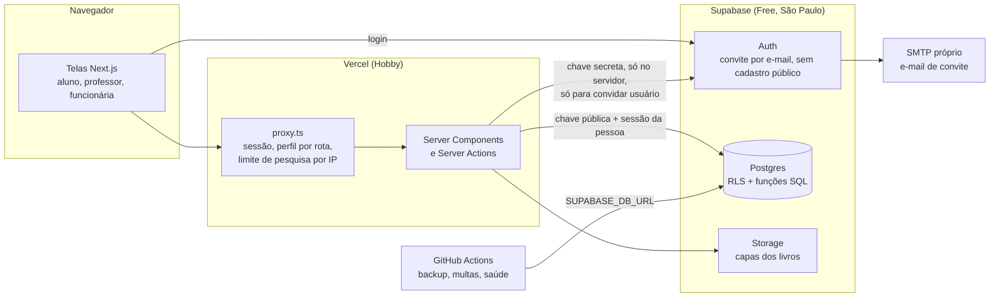
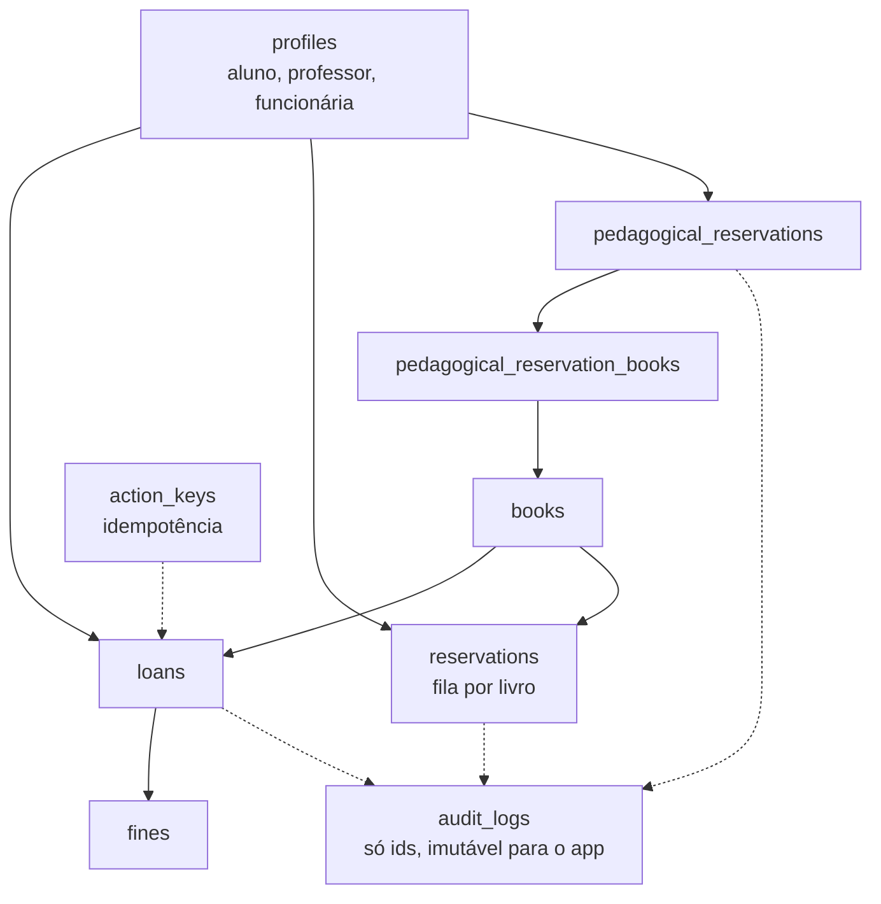

# Arquitetura

O FAP Books tem duas peças: o site (**Next.js 16**) e o **Supabase** (banco, login e arquivos). Não há API separada. Decisão de 08/10/2026: o time está aprendendo, então menos peças; NestJS só entra se o time decidir. Antes de criar pasta, camada ou tecnologia nova, pergunte ao responsável.

## Onde fica cada coisa

```text
src/
  app/              rotas (uma pasta por endereço): page.tsx, loading.tsx, error.tsx
  app/actions/      Server Actions (login, newsletter)
  components/       componentes, um por arquivo; todos reexportados em index.tsx
  services/         único lugar que fala com o Supabase (ex.: books.service.ts)
  domain/<tema>/    regras do negócio em funções puras, com teste ao lado
  types/            formato dos dados (book.ts, profile.ts)
  lib/supabase/     clientes do Supabase (browser-client.ts, server-client.ts, env.ts)
  lib/require-role.ts  confere o perfil na página
  content/          textos e listas da landing
  proxy.ts          protege as rotas por perfil (no Next 16 é o antigo middleware)
supabase/
  migrations/       todo o banco, versionado
  tests/            SQL das regras de acesso (RLS)
  seed.sql          dados de teste
scripts/arch/       geradores de feature e de migration
```

Código em inglês, textos da tela em português. Imports com `@/` apontando para `src/`.

## Regras de dependência

| Pasta | Pode usar | Não pode |
| -- | -- | -- |
| `app` | `components`, `services`, `domain`, `types`, `lib` | Falar com o Supabase direto |
| `components` | outros `components`, `domain`, `types` | Buscar dados, conhecer o Supabase |
| `services` | `lib`, `domain`, `types` | Importar de `app` ou `components` |
| `domain` | `types` | React, Next, Supabase |
| `types` | nada | Ter lógica |

Combinado: **a tela pede ao `service`, e só o `service` fala com o Supabase.**

## Como criar uma feature

1. Mova o card para In Progress e crie a branch `FAP/<número do card>`.
2. Gere a base: `scripts/arch/create-feature-web.sh books Book` (cria tipo, service, componente e rota com carregando, erro, vazio e sucesso). Se a feature já existe, o script não altera nada.
3. Troque os campos de exemplo pelos reais, começando por `src/types`.
4. Se mexe no banco: `scripts/arch/create-migration.sh create_books_table` e escreva o SQL (regras abaixo).
5. Regra do negócio (limite de 3 itens, prazo de 7 dias, multa de R$ 1,00 por dia) vai para `src/domain/<tema>/`, com teste. O service chama a regra antes de salvar.
6. Rode `npm run typecheck`, `npm run lint` e `npm test` (veja a seção [Qualidade de software](#qualidade-de-software) abaixo) e abra o PR para a `develop`.

Regras do código das telas:

- Um componente por arquivo, em `PascalCase`, com `interface` das props, e exportado em `index.tsx`.
- `page.tsx` só monta a tela: busca dados no servidor (`async`) e passa por props. `"use client"` só onde há estado, formulário ou clique.
- Toda tela com dados trata os 4 cenários: carregando, erro, vazio e sucesso.
- Sem `any`; sem regra de negócio dentro de componente.

## Login e permissões

- O login é o Supabase Auth. Existem 3 perfis em `profiles.role`: `student`, `teacher` e `librarian`.
- Duas barreiras no site: o `proxy.ts` leva quem não entrou ao `/login` e deixa cada perfil na própria área; cada página chama `requireRole` de novo.
- A terceira barreira é o banco (RLS, abaixo). Permissão nunca vale só na tela.
- Só variáveis `NEXT_PUBLIC_*` vão ao navegador. A chave `service_role` ignora o RLS: só em código de servidor, nunca no Git.

## Supabase: banco, RLS e arquivos

O projeto `fap-books` fica na região Brasil (São Paulo), no plano gratuito.

- **Toda mudança no banco é uma migration** em `supabase/migrations/`, no padrão `AAAAMMDDHHMMSS_verbo_objeto.sql`, uma ideia por arquivo. Ninguém muda o banco só pelo painel. **Nunca edite uma migration já aplicada**: crie outra.
- **RLS em toda tabela**: `alter table ... enable row level security;`.
- **`grant` mínimo.** O projeto não expõe tabelas automaticamente, então sem `grant` ninguém acessa. Depois, uma policy por perfil.
- Funções auxiliares como `is_librarian()` usam `security definer` e **sempre** `set search_path = ''`.
- Nomes: tabelas e colunas em `snake_case`, tabela no plural; `id uuid`; chave estrangeira `<tabela_singular>_id`; `created_at` e `updated_at`; dinheiro em centavos (`integer`).
- **Auditoria** (`audit_logs`) é gravada pelo servidor e guarda só ids, nunca nome, e-mail ou texto livre (veja [database/lgpd.md](database/lgpd.md)).
- **Storage:** capas ficam no bucket público `book-covers`; só a bibliotecária envia, troca ou apaga (policy em `storage.objects`).

Exemplo mínimo de tabela:

```sql
alter table public.books enable row level security;

grant select on public.books to authenticated;
grant insert, update, delete on public.books to authenticated;

create policy "books_select_logged_in" on public.books
  for select to authenticated using (true);

create policy "books_write_librarian" on public.books
  for all to authenticated
  using (public.is_librarian())
  with check (public.is_librarian());
```

Checklist de migration: nome no padrão; RLS ligado; `grant` e policies por perfil; `search_path` vazio nas funções `security definer`; índice nas colunas de busca; testado com aluno e bibliotecária (`supabase/tests/`). O modelo das tabelas está em [database/modelo-de-dados.md](database/modelo-de-dados.md).


## Regras de negócio que valem lembrar

**Multas (RF-22 e RF-23).**
- R$ 1,00 por dia de atraso (`fine_cents_per_day()` no banco e `FINE_PER_DAY_CENTS` em `src/domain/fines/fine-rules.ts`), em **dias corridos** entre o dia do prazo e o da devolução (ou de hoje, se o livro ainda não voltou), no calendário de Brasília. Devolver no dia do prazo, a qualquer hora, não é atraso. No máximo uma multa por empréstimo.
- Sábado, domingo, feriado e recesso **contam**: o regulamento do PRD não prevê exceção. Perdoar esses dias é decisão do dono e mexe em três lugares (`return_loan`, a tarefa diária e `calculateDaysLate`); está testado em `fine-rules.test.ts` para ninguém mudar sem perceber.
- Área do aluno (`/aluno`, `/aluno/emprestimos`, `/aluno/reservas`, `/aluno/multas`): `student.service.ts` lê só as linhas do aluno logado (filtro por id e RLS, sempre com limite); a renovação chama a `renew_loan` do banco, que confere dono, atraso, multa em aberto, reserva de outra pessoa e o limite de 3 renovações. Testes: `supabase/tests/07-area-do-aluno.sql`, `student-rules.test.ts` e `student.service.test.ts`.
- A mesma conta existe em três lugares: `return_loan` (grava a multa na devolução), `scripts/agendadas/multas-por-atraso.sql` (tarefa diária, cresce um dia por dia nos empréstimos em aberto e nunca altera multa paga) e `calculateFine` no código. Testes: `supabase/tests/04-pagar-multa.sql` e `fine-rules.test.ts`.
- A baixa é presencial e manual. `public.pay_fine(p_fine_id, p_idempotency_key)` é a única forma de gravar a baixa: só a funcionária, grava `paid_at` e `paid_by`, audita `fine_paid` só com ids e usa `claim_action_key`. Depois da baixa, `create_loan` e `renew_loan` deixam de bloquear o usuário por aquela multa.

**Relatórios (RF-27 a RF-29).** Tela `/funcionario/relatorios` (só funcionária: `RolePage`, `proxy.ts` e `decideRoute`) com três relatórios: livros em atraso, acervo por categoria e reservas pedagógicas. Os números saem de funções do banco (`report_overdue`, `report_inventory`, `report_pedagogical` e `report_pedagogical_counts`), todas `security definer` com `search_path` vazio e `is_librarian()`; cada uma devolve a página pedida e, em cada linha, o total do filtro inteiro (nunca mais de 1000 linhas por chamada) e usa índice (`idx_loans_open_by_due`, `idx_loans_returned_late`, `idx_books_category_status_qty`). O atraso usa a mesma regra da multa (dias corridos, Brasília, R$ 1,00 por dia); a multa do relatório é uma estimativa e, nos devolvidos, igual à gravada. "Disponíveis" do acervo desconta também os exemplares guardados por reserva pedagógica aprovada (como `book_availability`), por isso pode ser menor que o cartão do Painel, que só desconta empréstimos. Filtros (`tipo`, `de`, `ate`, `situacao`, `pagina`) ficam no endereço e são validados em `src/domain/reports/report-rules.ts`. A exportação é a rota de servidor `/funcionario/relatorios/exportar?formato=csv|pdf`: CSV em UTF-8 com BOM, separador `;` e células que começam com `=`, `+`, `-` ou `@` com apóstrofo; PDF escrito sem dependência (`src/domain/reports/report-export.ts`, Helvetica/WinAnsi, A4 deitado). Nada disso entra no pacote da tela. Testes: `supabase/tests/07-relatorios.sql`, `report-rules.test.ts` e `report-export.test.ts`.

**Fila de espera do livro indisponível (RF-13, cards 0044 e 0045).** Sem exemplar livre, aluno ou professor entra na fila do livro por ordem de chegada (`reserve_book`, só pela função: a tabela não aceita escrita direta). Uma reserva ativa por pessoa e livro (índice único parcial), com o mesmo limite de livros (3, ou 4 para formandos) e o mesmo bloqueio por atraso ou multa do empréstimo. Quando um exemplar volta, `return_loan` chama `promote_reservations`: o primeiro da fila vira `ready` (exemplar guardado) e tem `reservation_pickup_days()` = 2 dias para retirar (`expires_at`); passou do prazo, vira `expired` e a vez segue para o próximo (a expiração roda dentro das funções de empréstimo, devolução, reserva e cancelamento, e em `expire_overdue_reservations()` para uma rotina agendada, ainda não ligada). A pessoa cancela a própria reserva (`cancel_reservation`); a funcionária vê a fila no detalhe do livro, cancela, expira a pronta e abre o WhatsApp com a mensagem pronta (envio manual). Toda ação usa `claim_action_key` e é auditada (`reservation_created`, `reservation_cancelled`, `reservation_ready`, `reservation_expired`, só ids). Leituras: `list_my_reservations()` (as minhas, com posição) e `book_reservation_status()` (tamanho da fila e a minha situação), ambas sem dado de outras pessoas. No código: `src/services/reservations.service.ts` (`listMyReservations` é o contrato da tela "Minhas reservas", card 0216) e `src/domain/reservations/`. Testes: `supabase/tests/07-fila-de-espera.sql` e `07b-fila-concorrencia.sh`.

**Renovação da reserva pedagógica (RF-32, cards 0053 e 0055).** O professor pede mais dias de uma reserva aprovada na última semana do prazo (`renewal_window_days()` = 7) por `request_pedagogical_renewal`, que cria uma linha em `pedagogical_reservations` com `renewal_of` apontando para a original e entra na fila da funcionária marcada como "Renovação". Regras: só o dono, só reserva aprovada, dias de 1 até o limite configurável (`library_settings`), uma renovação pendente por reserva (índice único parcial) e período total de até 365 dias. A renovação não tem livros próprios (os exemplares são os da original), então o exemplar guardado nunca duplica e aprovar não exige exemplar livre. `decide_pedagogical_reservation` aprova (a original ganha os dias novos; se o fim já tinha passado, o novo período começa hoje) ou recusa (justificativa obrigatória; a original não muda). Os relatórios de reservas pedagógicas ignoram as linhas de renovação (`20261113600000`). Devolver a original (`return_pedagogical_reservation`) encerra as renovações: as aprovadas viram `returned` e a pendente vira `cancelled`. Auditoria: reaproveita `pedagogical_requested`, `pedagogical_approved` e `pedagogical_rejected`, com `renewal_of_id` nos detalhes. Testes: `supabase/tests/08-renovacao-reserva-pedagogica.sql` e `08b-renovacao-concorrencia.sh`; regras da tela em `src/domain/pedagogical/renewal-rules.ts`.

**Limite de dias da reserva pedagógica (RF-18).** O padrão é 30 dias e a funcionária altera na fila de reservas (campo "Prazo máximo (dias)", de 1 a 365). Fica na tabela `library_settings` e só se altera por `set_pedagogical_max_days()` (só funcionária, com auditoria). O limite vale na criação do pedido; reservas já feitas não mudam.

**Importação de livros por planilha.** `.csv` ou `.xlsx` (primeira aba), até 200 KB, 100 livros por envio, colunas `titulo`, `autor`, `categoria`, `codigo`, `quantidade` (obrigatórias) e `isbn`, `editora`, `edicao`. As linhas boas entram e as ruins voltam com o número da linha e o motivo (as que entraram não se repetem; código repetido recusa só aquela linha). O `.xlsx` só muda como as linhas são lidas: passa pelo mesmo `parseBookRows` (`src/domain/books/book-import.ts`). O arquivo é conferido antes de abrir: tipo pelos primeiros bytes (`PK` para zip), índice do zip sem descompactar, sem macro (`vbaProject.bin`), até 8 MB descompactado (proteção contra zip bomb), no máximo 500 linhas e 20 colunas; qualquer falha da biblioteca vira "arquivo inválido" sem mostrar a mensagem original.

---

## System design: visão do sistema

Resumo do porquê da arquitetura: componentes, dados, carga esperada, decisões (ADRs) e quando crescer. Os detalhes de cada parte ficam nos documentos citados; aqui está o quadro geral. Card 0232 (parte do 0225).

Complementa: as seções acima (pastas e regras de dependência), [database/modelo-de-dados.md](database/modelo-de-dados.md) (tabelas e RLS), [infra-e-plano-gratuito.md](infra-e-plano-gratuito.md) (limites, agendadas, backup e prova de carga) e [prd.md](prd.md) (requisitos).

### 1. Componentes



- **Navegador:** só recebe HTML e o JavaScript necessário. Nenhuma chave secreta chega a ele.
- **proxy.ts:** primeira porta. Renova a sessão, manda cada perfil para a própria área e limita a pesquisa (`?q=`) por IP. As páginas conferem o perfil de novo (`requireRole`): o proxy não é a única defesa.
- **Server Components e Actions:** todo acesso ao Supabase passa por `src/services/`. A leitura usa a sessão da pessoa, então o RLS vale. A chave secreta só existe em `src/lib/supabase/admin-client.ts` (convidar usuário), depois de conferir que quem pede é funcionária.
- **Banco:** as regras que não podem falhar moram no Postgres (ver seção 2), não só no código.
- **GitHub Actions:** tarefas agendadas fora do app (seção 4).

### 2. Dados e regras

Tabelas: `profiles`, `books`, `loans`, `fines`, `reservations`, `pedagogical_reservations`, `pedagogical_reservation_books`, `audit_logs`, `action_keys` e `newsletter_subscribers`. Todas com RLS ligado. O desenho completo está em `database/modelo-de-dados.md`.



Regras de negócio no banco (funções `security definer` com `search_path` vazio, só para usuário logado, conferindo o perfil dentro da função):

| Regra | Onde |
| -- | -- |
| Limite de 3 livros por usuário (4 para formandos), exemplar livre, fila de reserva | `loans_enforce_integrity`, `create_loan`, `return_loan`, `renew_loan` |
| Prazo de 7 dias; renovação até 3 vezes somando 7 dias ao prazo atual | funções de empréstimo e renovação |
| Multa de R$ 1,00 por dia (dias corridos, fuso America/Sao_Paulo); baixa só presencial | `pay_fine`, tarefa agendada de multas |
| Reserva pedagógica (até 30 dias): pedir, registrar no balcão, aprovar/recusar, devolver | `request_`, `register_in_person_`, `decide_`, `return_pedagogical_reservation` |
| Painel e edição/inativação de usuários | `panel_summary`, `update_profile_admin`, `set_profile_active` |
| Concorrência: dois pedidos do último exemplar, só um passa | `select ... for update` no livro e no perfil, sempre na mesma ordem |
| Clique duplo e nova tentativa não duplicam | chave de idempotência por ação (`claim_action_key`, `action_keys`) |

Auditoria: `audit_logs` guarda só identificadores (LGPD), é imutável para o app e tem política de retenção de 24 meses (ver `infra-e-plano-gratuito.md`).

### 3. Carga esperada (hipóteses a validar)

A biblioteca atende a comunidade de uma faculdade. Os números abaixo são **hipóteses de projeto**, não medição:

| Item | Hipótese | Por que importa |
| -- | -- | -- |
| Usuários cadastrados | centenas a poucos milhares | o plano gratuito comporta; a lista de usuários é paginada |
| Acervo | até 20 mil títulos | a busca precisa de índice e paginação; o teste de carga usa essa meta |
| Pico simultâneo | 50 pessoas (início de semestre) | meta do card 0225: p95 abaixo de 500 ms e zero erro com 50 usuários |
| Escritas | dezenas de empréstimos por dia | baixo; o cuidado é correção (concorrência), não volume |
| Banco hoje | 13 MB com 20 livros | limite do plano: 500 MB; alerta em 80% |

Leitura domina a escrita: pesquisa de livros é a rota mais quente. Por isso a busca, os contadores e a disponibilidade são funções SQL com paginação (nunca ler o acervo inteiro em memória), e só dado compartilhado entra em cache.

### 4. Decisões (ADRs)

| # | Decisão | Motivo | Consequência |
| -- | -- | -- | -- |
| 1 | Backend em Next.js (Server Actions) + Supabase; NestJS adiado | Time em aprendizado, menos peças, plano gratuito (registrado no PRD) | Regras críticas no banco para não depender de um servidor de API |
| 2 | Regras que não podem falhar viram funções SQL transacionais, não código de tela | Concorrência e integridade (limite, exemplar, fila) só são garantidas no banco | Testes SQL em `supabase/tests/` rodam em Postgres descartável |
| 3 | RLS em toda tabela e leitura com a sessão da pessoa | Aluno e professor só veem o que é deles | Chave secreta fora do navegador, usada só para convidar |
| 4 | Idempotência por chave de ação | Clique duplo e falha de rede não duplicam empréstimo ou multa | Tabela `action_keys` |
| 5 | Cache (`use cache` + `cacheTag`) só para dado compartilhado (categorias); dado por usuário nunca | O RLS torna cada resposta diferente por pessoa | Escritas chamam `invalidateCatalogCache()` |
| 6 | `` simples nas capas, com `loading="lazy"` | O otimizador de imagem da Vercel tem cota própria no plano gratuito | Capas pequenas (2 MB) e cache de 1 ano |
| 7 | Limite por IP em memória (pesquisa, newsletter) e no Supabase Auth (login) | Custo zero | **Não é global** (cada instância tem a sua memória); a garantia global é o WAF da Vercel, a cargo do dono |
| 8 | Tarefas agendadas no GitHub Actions executando SQL idempotente, em lote com limite | Usa o segredo que já existe (`SUPABASE_DB_URL`), sem conta nova; multa nunca é calculada na leitura | O GitHub só agenda a partir da `main` e pausa repositório sem atividade por 60 dias |
| 9 | Cadastro público do Supabase desligado; pessoa nova entra por convite | Impede conta de estranho (perfil nasce como aluno ativo) e abuso do e-mail | Convite pela funcionária usa a chave de servidor |
| 10 | SMTP próprio (Gmail na fase piloto) | O e-mail padrão do Supabase é limitado e sem identidade | Gmail serve ao piloto; para uso real, trocar por Resend ou Brevo com domínio |
| 11 | Orçamento de JavaScript no CI (`scripts/orcamento-bundle.mjs`) | Evitar piorar o desempenho sem perceber | Teto sobe de propósito, no mesmo PR, com explicação |
| 12 | Auditoria só com ids, 24 meses de retenção, apagar só com decisão humana | LGPD e custo de armazenamento | Workflow semanal conta; apagar é manual |

### 5. Observabilidade e operação

- **Backup:** diário, criptografado (seção "Backup do banco" de `infra-e-plano-gratuito.md`).
- **Saúde do Supabase (semanal):** mantém o projeto ativo, mede banco e arquivos (alerta em 80%), conta auditoria antiga, lista consultas lentas (`pg_stat_statements`) e roda os advisors por SQL (`scripts/agendadas/advisors.sql`, sem token novo).
- **Erros do servidor:** log estruturado sem PII em Vercel > Logs (`src/instrumentation.ts`); Sentry fica como evolução (precisa de conta, DSN e pacote). Decisão e limites em `infra-e-plano-gratuito.md`, seção 3.
- **Alertas:** `verificacao-do-site.yml` (site fora do ar) e `alerta-falha-rotina.yml` (backup, multas, saúde ou verificação falharam) abrem issue e o GitHub avisa por e-mail.
- **Segurança:** última verificação em 09/11/2026 (RLS em todas as tabelas, anônimo recusado em tabelas e funções, sem segredo no repositório nem no bundle, 0 vulnerabilidades no `npm audit`).

### 6. Plano de crescimento

Gatilhos para sair do plano gratuito, nesta ordem de probabilidade:

1. **E-mail:** convites em volume ou fora do piloto: trocar o Gmail por Resend ou Brevo, com domínio próprio.
2. **Pausa por inatividade:** o Supabase pausa o projeto após 7 dias sem uso (o workflow semanal mantém ativo). Se a pausa começar a atrapalhar a operação, ou for preciso backup gerenciado: plano Pro.
3. **Espaço:** banco acima de 400 MB ou arquivos acima de 800 MB (80% dos limites): limpar capas órfãs e comprimir; se não bastar, plano Pro.
4. **Uso comercial ou cota da Vercel:** o plano Hobby não permite uso comercial; passar para o Pro se a biblioteca for operada como serviço pago.
5. **Limite global por IP:** WAF da Vercel (ou Upstash) quando houver tráfego real; hoje o limite do app é por instância.
6. **Acervo muito grande:** particionar `audit_logs` por mês e revisar índices (`pg_trgm` para a busca por texto) conforme o `EXPLAIN ANALYZE`.

A decisão de custo é do dono do projeto.

### 7. O que ainda não está provado

- **Prova de carga com os números oficiais: rodada em 13/11/2026; a listagem melhorou 3x com o card 0260 mas ainda NÃO bate p95 < 500 ms** (o gargalo agora é o processo Node, não o banco). Detalhes abaixo.
- **Limite global por IP:** depende de o dono aplicar a regra do WAF.
- **Avisos de vencimento (RF-24) por canal externo:** o e-mail está feito (tarefa agendada, tabela `loan_email_notices`, provedor trocável; veja `docs/email/README.md`). O WhatsApp depende de o dono definir o canal. O painel já mostra os avisos de prazo.
- **Lighthouse no CI:** evolução opcional; o orçamento de JavaScript já roda.

#### Resultado da prova de carga (card 0235, 13/11/2026)

**Ambiente:** máquina de desenvolvimento (16 CPUs, 15 GB, **compartilhada com outras sessões de trabalho**: carga média de 8 a 11 durante os testes, então os números são pessimistas e variam). Pilha local do FAP com o Supabase CLI (Postgres 17, PostgREST, Auth, Storage, em portas próprias) com as 34 migrations, `supabase/seed.sql` e **20.020 livros** (`scripts/seed-carga.sql`). App em modo de produção (`next build` e `next start`, **um único processo Node**, sem a escala horizontal da Vercel). Um aluno de teste logado (cookie de sessão). 50 usuários simultâneos, 20 s por rota, **sem pausa entre pedidos** (cada usuário dispara o próximo assim que recebe a resposta: bem mais duro que uso real).

| Rota | Pedidos/s | Erros | p50 | p95 | p99 | Meta (p95 < 500 ms, 0 erro) |
| -- | -- | -- | -- | -- | -- | -- |
| `/` (pública) | 627 | 0 | 72 ms | **120 ms** | 236 ms | **Bateu** |
| `/aluno/livros` (listagem, 20 mil livros) | 32 a 39 | 0 | 1.359 a 1.476 ms | **1.597 a 2.253 ms** | 2,4 s | **Não bateu** |
| `/aluno/livros/<id>` (detalhe) | 73 a 125 | 0 | 373 a 694 ms | **672 a 1.108 ms** | 1,8 s | **Não bateu** (varia com a carga da máquina) |
| `/aluno/livros?q=...` (busca) | n/a | 10.588 de 10.707 | n/a | n/a | n/a | O limitador de 60 buscas por minuto por IP respondeu 429 (correto). A busca com termo seletivo foi medida no banco: 1,3 ms (índices `pg_trgm`) |

**Gargalo da listagem (EXPLAIN ANALYZE):** o Postgres chegou a ~460% de CPU. A função `search_books` numera **todas** as linhas do acervo (`row_number() over (order by ...)` e filtro por `rn`) e portanto ordena 20 mil linhas a cada página: ~25 ms de Sort dentro de 32 ms de execução (mais ~7 ms de seq scan e joins). A mesma consulta com `ORDER BY title, id LIMIT 12 OFFSET 0` leva **0,18 ms** (usa `idx_books_title`). Um protótipo local, não comitado, com essa troca levou a listagem de p95 2.253 ms para **806 ms** e de 39 para 84 pedidos/s; o que sobra é o limite de um processo Node na máquina compartilhada (o Next usou ~140% de CPU). **Correção: card 0260 (P1), resultado na seção "Depois do card 0260" abaixo.**

**Gargalo do detalhe:** não é o banco (média de 0,7 ms por consulta, 24% de CPU do Postgres); é o processo Node renderizando, e a variação entre rodadas acompanha a carga da máquina. Com pedidos reais (pausa de segundos entre cliques) a vazão exigida é de ~10 pedidos/s para 50 pessoas, muito abaixo dos 73 a 125 medidos, e a Vercel escala as execuções; mesmo assim **não está provado** em produção e prova de carga nunca roda contra produção.

**Limites desta prova:** um só aluno (cookie único; o RLS é por pessoa, mas o custo é o mesmo), um só processo, máquina compartilhada, sem rede entre app e banco. Refazer depois do card 0260, de preferência em máquina ociosa.

#### Depois do card 0260 (13/11/2026)

**Correção:** a migration `20261113700000_search_books_paginacao_no_banco.sql` troca o `row_number()` sobre o acervo por `ORDER BY ... LIMIT ... OFFSET` na própria consulta (a ordem por título e por autor usa índices novos de `books`; ISBN e "tem histórico" só das linhas da página). Mesmo contrato: mesmas colunas, ordens, `total_count`, página além do fim devolve a última. Conferido contra a função antiga em 8.640 combinações de filtro, ordem e página: **0 divergências**. A função usa `plan_cache_mode = force_custom_plan` (sem isso, depois de 5 chamadas o plpgsql reaproveita um plano genérico que volta a ordenar tudo). Também entrou o índice parcial das novidades (`status = 'active' and cover_url is not null`, por `created_at desc`), que evita ler o acervo todo na home e na pesquisa do aluno.

**Banco (mínimo de 7 execuções, 20.020 livros, 763 empréstimos abertos, 111 reservas):**

| Consulta | Antes | Depois |
| -- | -- | -- |
| `search_books` p1, sem filtro | 35 ms | 3 ms |
| por título / por autor, p1 | 34 / 44 ms | 3 / 3 ms |
| categoria, p1 | 17 ms | 2 ms |
| situação "disponível" / "reservado" | 48 / 21 ms | 16 / 8 ms |
| "disponíveis primeiro", p1 | 51 ms | 15 ms |
| página 500 (offset de 6 mil) | 35 ms | 22 ms |
| termo seletivo ("livro de carga 0042") | 12 ms | 3 ms |
| termo que acha tudo ("carga"), relevância | 263 ms | 150 ms |
| termo que acha 10% ("autor 7") | 77 ms | 42 ms |
| funcionária, todos os status, título, p1 | 36 ms | 2 ms |
| `book_situation_counts` sem filtro | 10 a 12 ms | 6 ms |
| `book_availability_for_books` (detalhe) | 2 ms | 0,3 ms |

Dos 3 ms de `search_books` p1, cerca de 2 a 3 ms são a contagem exata (`total_count`, ~20 mil linhas em índice): foi mantida exata para não mudar a paginação das telas. Por pedido real da listagem, o banco gasta ~7,6 ms no total (antes ~37 ms): `search_books` 5 ms, novidades 1,9 ms (agora ~0 com o índice) e disponibilidade 0,5 ms.

**Aplicação (mesmo ambiente: pilha local, `next start` em um processo, 50 usuários, 20 s, sem pausa; máquina compartilhada):**

| Rota | Antes | Depois | Meta |
| -- | -- | -- | -- |
| `/aluno/livros` | 44 pedidos/s, p95 **1.996 ms** | 85 a 92 pedidos/s, p95 **627 a 721 ms** | **Não bateu** |
| `/aluno/livros/<id>` | 128 pedidos/s, p95 454 ms | 115 a 128 pedidos/s, p95 532 a 568 ms | Varia entre 450 e 570 ms (ruído da máquina; o banco gasta ~1 ms) |
| `/` | 897 pedidos/s, p95 74 ms | 835 pedidos/s, p95 74 a 80 ms | Bateu |

**O que falta (próximo gargalo):** a listagem passou de 2 s para ~0,65 s e dobrou a vazão, mas não chegou a 500 ms. O Postgres está a ~0,8 CPU para 100 pedidos/s; o **processo Node chega a ~145% de CPU** (cerca de 15 ms de CPU por pedido, página de ~100 KB com 12 cards, proxy e perfil consultados a cada pedido). Com 50 usuários sem pausa e um só processo, p95 < 500 ms exigiria ~110 pedidos/s. Esse limite é do ambiente de teste (um processo; a Vercel escala as execuções) e do custo de renderização por pedido. Está registrado no card 0265 para medir o custo de renderização (perfil do Node) e, se preciso, reduzir consultas por pedido. A prova ainda não foi feita em ambiente de produção real e nunca roda contra produção.


---

## Qualidade de software

Esta é uma **regra do projeto**: todo código que entra (de qualquer pessoa da equipe) precisa ser **limpo**, **fácil de a equipe entender** e **seguro**. Ela vale para PR de código, de banco e de documentação técnica.

### 1. Código limpo e fácil de entender

- **Nomes claros**, em português nos textos da tela e nas regras de negócio, e que dizem o que a coisa faz.
- **Componentes e funções pequenos**, com uma responsabilidade só. Se precisa de "e" para descrever, divida.
- **Textos e dados fora do JSX**: textos de seção, listas e números ficam em constantes no topo ou em arquivo de conteúdo, não espalhados no meio da marcação.
- **Regras de negócio puras em `src/domain`**, com teste ao lado (`*.test.ts`). Telas só chamam serviços; só os serviços falam com o Supabase.
- **Comentário curto explicando o porquê**, não o que a linha faz. Sem código morto nem comentado.
- **Reuse antes de criar**: use `Button`, `Logo`, `PageHeader` e os tokens do design system (`globals.css`) em vez de repetir classes.
- **Acessível por padrão**: rótulos, foco visível, `alt` útil (ou vazio em imagem decorativa), contraste do design system.

### 2. Segurança

- **Nenhum segredo no código** nem no Git: chaves ficam em `.env.local` e nos segredos do GitHub/Vercel. Só a chave pública (`NEXT_PUBLIC_*`) vai ao navegador.
- **Valide toda entrada no servidor** (ação, rota, formulário), mesmo que a tela já valide. Nunca confie no que vem do navegador.
- **Permissão no servidor, não só na tela**: cada ação confere o perfil (`requireRole`), e o banco protege com **RLS em toda tabela**.
- **Menor privilégio**: ninguém recebe mais acesso do que precisa; a chave de serviço do Supabase nunca vai ao navegador.
- **Dados pessoais (LGPD)**: só o necessário; auditoria guarda **só ids**, nunca nome, e-mail ou texto livre (ver `docs/database/lgpd.md`).
- **Nada de `dangerouslySetInnerHTML`** nem montar SQL ou HTML com texto de usuário. Links externos com `rel="noopener noreferrer"`.
- **Mensagens de erro próprias**: nunca mostrar o erro bruto do banco ou do servidor.
- **Dependências**: só as necessárias e conhecidas; rodar `npm audit` antes de uma release.

#### Alertas do Dependabot aceitos

Regra: alerta em dependência que vai para produção se corrige na hora (`npm audit --omit=dev` precisa dar 0). Alerta só de ferramenta de desenvolvimento, sem correção compatível, pode ser aceito, desde que fique registrado aqui e o motivo no próprio alerta.

| Alerta | Pacote | Onde entra | Decisão |
| -- | -- | -- | -- |
| #2 (GHSA-g3hv-75wg-m249, moderado 6,9) | `minimatch` < 11.0.1 | só no ESLint e nos plugins dele (`eslint`, `eslint-plugin-import`, `jsx-a11y`, `react`, `typescript-estree`); não está na produção (`npm ls minimatch --omit=dev` vazio) | **Aceito em 03/11/2026 (risco tolerável).** A falha pede um padrão de glob controlado por quem ataca; aqui os padrões vêm dos nossos próprios arquivos de configuração. Não há correção compatível: até o ESLint 10.14 pede `minimatch` ^10, e os plugins pedem ^3, e a versão 11 muda a forma de importar (forçar com `overrides` quebraria o lint). O `npm audit fix --force` instalaria o ESLint 4, o que também quebraria. **Rever** quando o ESLint, o `typescript-eslint` e os plugins atualizarem. |

### 3. Antes de abrir o PR

Rode e confirme que passa:

```bash
npm run typecheck
npm run lint
npm test
npm run build
```

Se algum falhar, não abra o PR: leia a mensagem, corrija e rode de novo. O CI roda os mesmos quatro passos.

O que testar: o que, se quebrar, dá prejuízo. As regras do negócio (limite de 3 itens, prazo de 7 dias, multa de R$ 1,00 por dia, reserva pedagógica de até 30 dias), com um teste do caso certo e um do caso que deve falhar; e a segurança do banco (o aluno lê só o dele). Os testes ficam ao lado do código, em `*.test.ts` (Vitest).

PR bom: pequeno (uma ideia), com título e descrição claros (o que mudou, por quê, como testar), branch `FAP/<número do card>`, commits com `feat:`, `fix:`, `docs:`, `chore:` ou `ci:`, sem `console.log`, código comentado ou arquivo fora da tarefa. Teste a tela em desktop e celular.

E marque o checklist do modelo de PR (`.github/pull_request_template.md`). Quem revisa confere os mesmos pontos e pode pedir ajuste: qualidade e segurança não são opcionais. Perguntas da revisão: entendi o que o código faz? Está na camada certa (veja as seções acima)? Tem teste da regra? Se o banco mudou, tem migration, RLS e `grant`? Algum nome pode ser mais claro?

