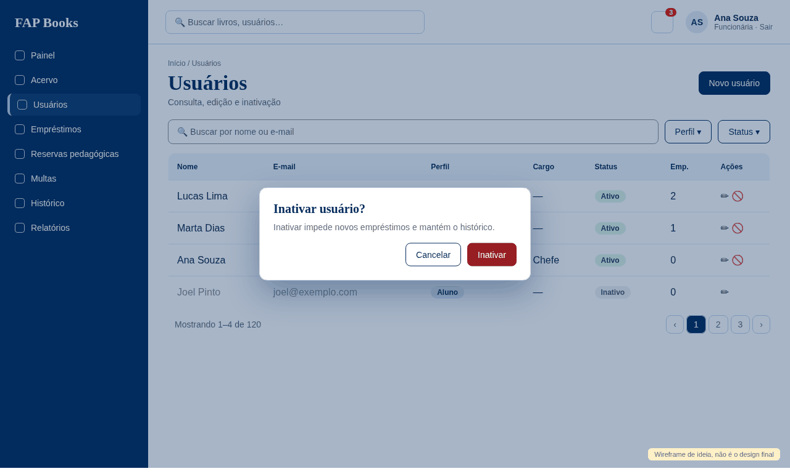

# [FAP - 0126] Listagem, edição e inativação de usuários

Card do Trello: https://trello.com/c/intnf8DF
Tela: **listagem, edição e inativação de usuários**.

## Referência visual

Wireframe de ideia: `docs/design/referencias/0126-referencia.png`. Mostra a estrutura e os estados principais, **não é o design final**: o visual segue `docs/design/stitch/DESIGN.md` e o Figma.

