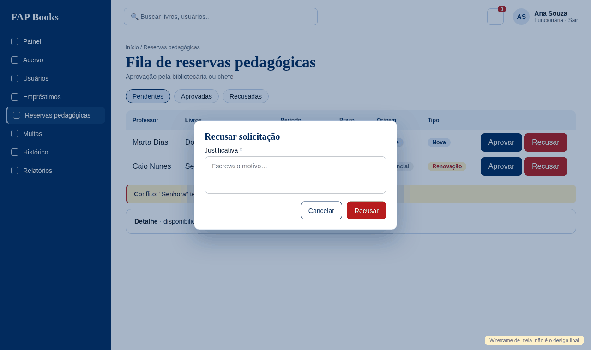

# [FAP - 0140] Fila de aprovação de reservas pedagógicas

Card do Trello: https://trello.com/c/AhcNKKdn
Tela: **fila de aprovação de reservas pedagógicas**.

## Referência visual

Wireframe de ideia: `docs/design/referencias/0140-referencia.png`. Mostra a estrutura e os estados principais, **não é o design final**: o visual segue `docs/design/stitch/DESIGN.md` e o Figma.

